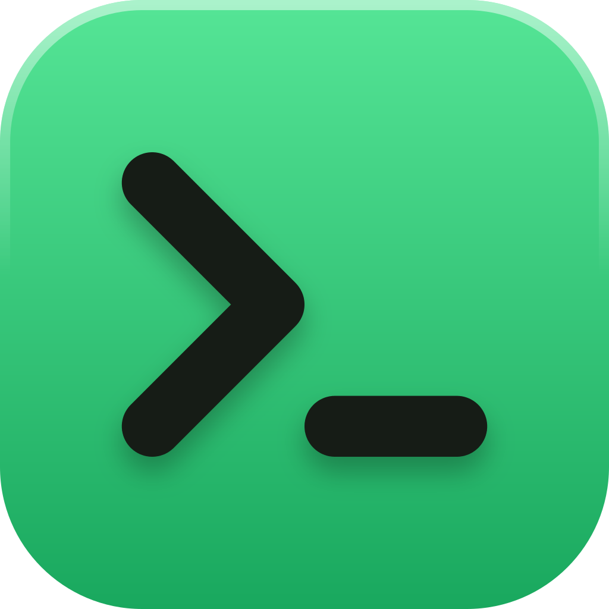
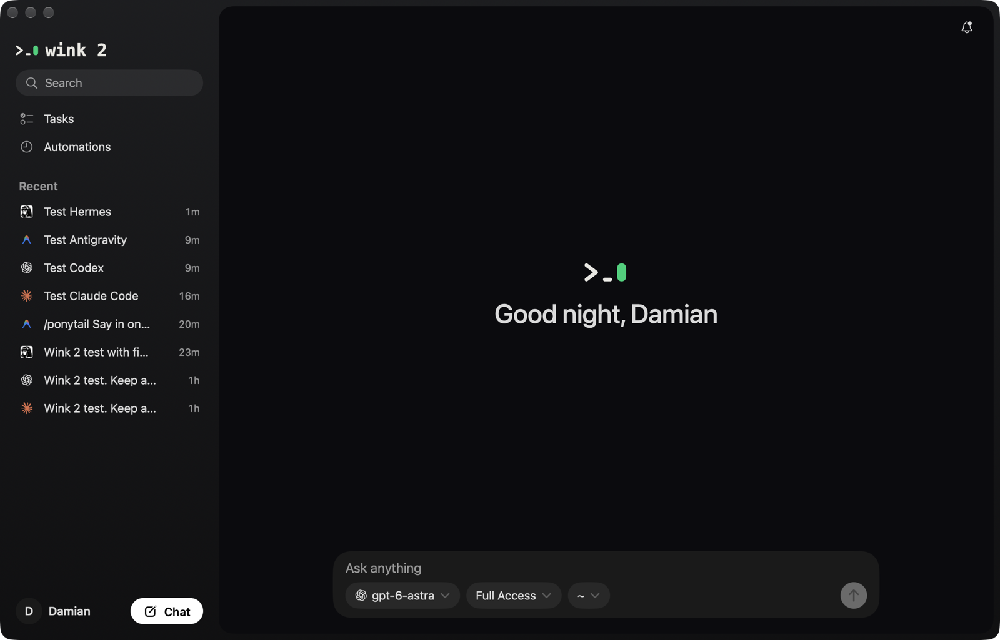
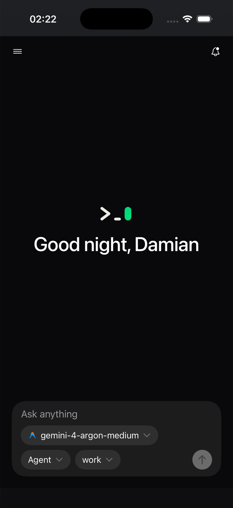

  

<h1 align="center">Wink</h1>

One quiet app for all my AI coding agents, on the Mac and the iPhone.

  
  &nbsp;
  

## What it is

Wink is a personal, self-hosted app that runs the AI agents I already use, Claude Code, Codex,
Antigravity and Hermes, side by side in one chat window. A small engine on my Mac starts each agent
through its own official machine-readable interface and the app shows the chat the way that agent
would show it. The same chats are open on my iPhone, so I can start a job at my desk and check on it
from anywhere.

It is a thin shell on purpose: the agent's own way always wins over a Wink idea. If an agent cannot do
something (for example, ask for permission in headless mode), Wink marks it as missing instead of faking it.

## What it does

- **Four agents, one chat list.** Pick a model, and Wink picks the agent that runs it. Each chat carries
  the agent's mark and colour.
- **Native output per agent.** One small adapter per agent reads its official stream:
  Claude Code `stream-json`, the Codex app server, Antigravity `stream-json` and Hermes over the
  Agent Client Protocol. Tool calls, plans, to-do lists, subagents and permission requests show up as
  the agent sends them.
- **The agent's own permission modes.** Each chat uses the modes the agent itself offers. Wink never
  adds a bypass of its own.
- **Shared setup.** All agents read the same instructions, skills and MCP connections, and a startup
  check shows whether each one really sees them.
- **Tasks.** A to-do list the agents keep up to date: they add what needs me and tick what they finished.
- **Automations.** Scheduled jobs that start a real chat in the right agent at a set time.
- **Video review.** A video path in an answer becomes a review card with a player, notes at a time and
  marked areas, on the Mac and the iPhone.
- **iPhone app.** The same chats, tasks and automations, reached over a private network.

## Design

Black and quiet, like its own logo: a prompt, a cursor and a green pill. White text, green only for small
things like "working". One set of design pieces in the app, and the build refuses a screen that reaches
for anything else.

## Built with

- SwiftUI for the Mac and iPhone app
- A Swift engine (local HTTP server) that runs the agents and stores chats, tasks and automations
- Built largely together with AI coding agents

## Status

Wink is my personal daily tool, not a product. The source code stays private for now because it is
wired into my own machines and accounts. This repo shows what it is and how it works.
